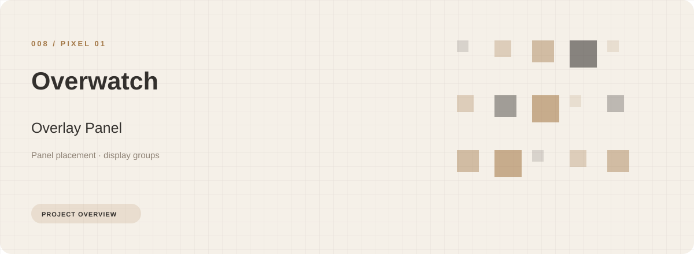
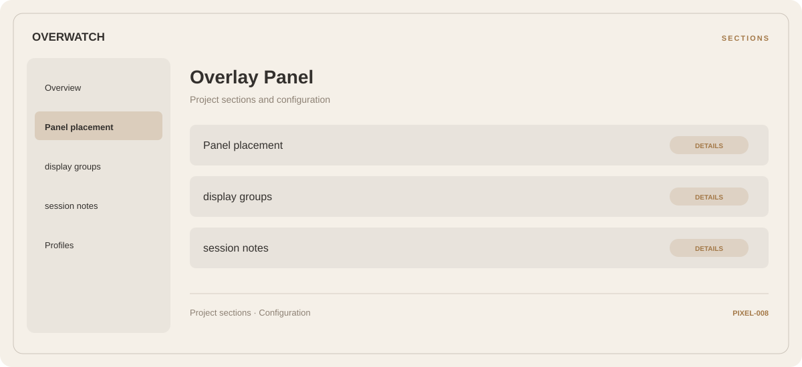

# 🛠️ Overwatch Overlay Panel

**Panel placement · Display groups · Session notes**

## ⚡ Features

Overwatch Overlay Panel uses a concise workspace for panel placement, display groups, and session notes. The feature map follows the same order as the project navigation.

### ⚙️ Panel placement

A dedicated section for panel placement and the configuration details associated with that area.

### 🧩 Display groups

Display or performance-related options, with space for configuration and comparison information.

### ⌨️ Session notes

Session and activity information grouped by the task or context it belongs to.

## 🖥️ Project navigation

## 📥 Download

The button and cover open the project's download page. Use the information supplied with the downloaded package for installation and release-specific requirements.

## 📚 Project documentation

- [Feature reference](docs/FEATURES.md)
- [Download information](docs/DOWNLOAD.md)
- [Project page](index.html)

---

Overwatch Overlay Panel · Program documentation and download information.
